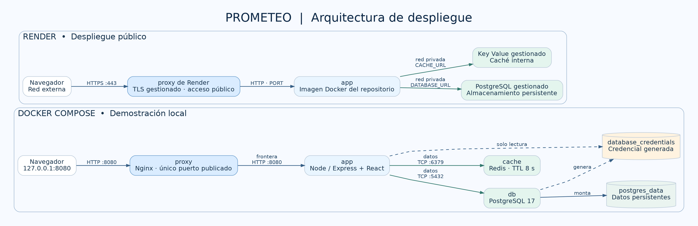

# Prometeo

**Despliegue público** · [https://prometeo-yopal-dbua.onrender.com](https://prometeo-yopal-dbua.onrender.com)
**Repositorio** · [BecerritoBiker/Prometeo](https://github.com/BecerritoBiker/Prometeo)

Aplicación de reportes ciudadanos de Yopal, Casanare. Base de SERAFY adaptada para la Entrega 4 de Tecnologías Web de Unitrópico. El mapa y los indicadores son públicos. Una cuenta ciudadana puede consultar sus reportes, y un moderador puede actualizar sus estados.

## 1. Levantar en una máquina limpia

1. Instala y abre Docker Desktop, o usa Docker Engine con Compose v2.
2. Clona el repositorio. Si recibiste el ZIP, descomprímelo y entra en la carpeta `prometeo`.
3. Desde esa carpeta ejecuta un solo comando.

   ```bash
   docker compose up --build -d --wait
   ```

4. Abre [Prometeo](http://localhost:8080) y consulta `docker compose ps`. Los cuatro servicios deben aparecer `healthy`.

| Recurso | Dirección |
| --- | --- |
| Portada optimizada | http://localhost:8080/ |
| Línea base para Lighthouse | http://localhost:8080/?medicion=base |
| Salud y estado de la caché | http://localhost:8080/api/health |
| Versión y revisión desplegada | http://localhost:8080/api/version |
| Especificación OpenAPI | http://localhost:8080/api/openapi.yaml |

Si el puerto 8080 está ocupado, usa `APP_PORT=8081 docker compose up --build -d --wait` en macOS o Linux y abre el puerto 8081. Para diagnosticar un fallo consulta `docker compose logs --tail 80 proxy app db cache`.

## 2. Arquitectura



`proxy` publica el único puerto local y comunica el navegador con `app` por la red `frontera`. Node sirve React y la API desde el mismo origen. La red interna `datos` conecta `app` con `db` y `cache`. PostgreSQL conserva los reportes en `postgres_data`. Redis guarda durante ocho segundos los indicadores públicos y vuelve a calcularlos cuando hay cambios. Si se interrumpe la caché, la API usa PostgreSQL.

En Render, el proxy TLS es del proveedor. La aplicación corre desde el mismo Dockerfile y utiliza PostgreSQL y Key Value gestionados por la red privada. Consulta el [modelo de datos](docs/modelo-datos.md) y las [decisiones técnicas](docs/decisiones.md).

## 3. Configuración

Compose establece los valores para el arranque local y genera la credencial de PostgreSQL en el volumen `database_credentials`. Conserva ese volumen junto con `postgres_data`. En Render las conexiones y la contraseña inicial se generan en el entorno privado.

| Variable | Uso | Obligatoria |
| --- | --- | --- |
| `APP_PORT` | Puerto publicado por Compose. Predeterminado 8080. | No |
| `PORT` | Puerto interno de Node. Render lo inyecta. | No |
| `DATABASE_URL` | Conexión privada a PostgreSQL. Tiene prioridad. | Sí, en Render |
| `DB_HOST`, `DB_NAME`, `DB_USER` | Host, base y usuario para conexión por archivo. | Sí, si no usas `DATABASE_URL` |
| `DB_PASSWORD_FILE` | Ruta a la credencial generada. | Sí, si no usas `DATABASE_URL` |
| `DB_PORT` | Puerto PostgreSQL. Predeterminado 5432. | No |
| `CACHE_URL` | Dirección interna de Redis o Key Value. | Compose y Render la asignan |
| `COOKIE_SECURE`, `TRUST_PROXY` | Cookies HTTPS y número de proxies de confianza. | Sí, detrás del proxy HTTPS |
| `BOOTSTRAP_ADMIN_EMAIL`, `BOOTSTRAP_ADMIN_PASSWORD` | Cuenta de administración inicial. | Opcionales, se usan en pareja |
| `RENDER_GIT_COMMIT` | Revisión del despliegue mostrada por la API. | Render la inyecta |

## 4. Publicar y revertir

1. Sube el contenido del ZIP, incluidos `.github`, `.env.example` y `.dockerignore`, al repositorio en la rama `main`. Si el repositorio ya tiene un primer commit, clónalo y copia el contenido del ZIP sobre esa carpeta antes de agregar y subir los cambios.
2. En [Render](https://dashboard.render.com/) conecta el proveedor GitHub y crea un **Blueprint** desde el repositorio. Revisa y aplica `render.yaml`, que declara el servicio Docker, PostgreSQL y Key Value. Los tres usan el plan gratuito.
3. Abre la URL que Render asignó. Comprueba `/api/health` y `/api/version`. Guarda el enlace público en las primeras líneas de este README.
4. En **Environment** del servicio consulta de forma privada `BOOTSTRAP_ADMIN_PASSWORD`. El correo inicial es `admin-evaluacion@prometeo.example`. En **Gestión → Administrar roles y categorías** puedes asignar el rol de moderador a una cuenta de evaluación.

Cada push a `main` ejecuta **CI/CD Prometeo**. El flujo construye Compose, verifica integración, persistencia y permisos, y publica la imagen en GHCR con etiqueta `sha-<commit>`. Render reconstruye el mismo commit desde el Dockerfile cuando los checks pasan. Una prueba fallida bloquea la publicación de imagen y la actualización del servicio. En un pull request se prueban los cambios antes de integrarlos.

Para la entrega ejecuta **Actions → CI/CD Prometeo → Run workflow** en `main`, con `etiquetar_version` activado y `simular_fallo` desactivado. Tras pasar las pruebas se publican el tag Git `v0.4.0` y la imagen `ghcr.io/becerritobiker/prometeo-entrega-4:v0.4.0`. Verifica la visibilidad del paquete en GitHub Packages para el evaluador. Si el registro rechaza el token automático, un propietario puede conceder acceso al repositorio en el paquete o configurar el secreto de Actions `GHCR_WRITE_TOKEN` con permiso de publicación.

Si necesitas revertir la versión pública, elige el despliegue anterior desde **Render → Events**. Para mantener la reversión en futuras integraciones, usa un commit que revierta el cambio en `main`. Un rollback de la aplicación no revierte automáticamente los datos ni las migraciones.

El servicio gratuito puede entrar en reposo y tardar en despertar. La base gratuita de Render vence a los 30 días. [Planes gratuitos](https://render.com/docs/free) · [Despliegues](https://render.com/docs/deploys) · [TLS](https://render.com/docs/tls)

## 5. Probar y sustentar

1. Registra dos cuentas. Para convertir una en moderadora en local ejecuta lo siguiente, sustituyendo el correo por el de esa cuenta.

   ```bash
   docker compose exec app node server/manage-role.mjs correo-de-prueba@example.test moderator
   ```

2. Como ciudadano crea un reporte, selecciona la ubicación y ábrelo desde **Ver reporte en el mapa**. En **Mis reportes** puedes editar su título y descripción. La API devuelve **403** si esa cuenta intenta moderar.
3. Entra como moderador, registra un seguimiento y avanza de **Nuevo** a **En verificación**. Consulta el historial en el mapa.
4. Reinicia todo con `docker compose restart` y espera con `docker compose up -d --wait`. Reabre el reporte y muestra que conserva su estado e historial. `docker compose down` conserva los volúmenes. `docker compose down --volumes` elimina la base de pruebas y su credencial.
5. En GitHub Actions genera una ejecución roja con `simular_fallo`. El test exige deliberadamente una respuesta de salud incorrecta antes de escribir datos. Observa que **Publicar imagen en GHCR** se omite.
6. Ejecuta **Lighthouse de la URL pública** en GitHub Actions con la URL de Render. Descarga el artefacto con HTML, JSON y tabla. En un equipo con Node 22.19+ y Chrome puedes ejecutar lo siguiente.

   ```bash
   bash scripts/medir-rendimiento.sh https://URL-DE-TU-APP.onrender.com docs/lighthouse-publico
   ```

Consulta el [informe de rendimiento](docs/informe-rendimiento.md), [evidencias](docs/evidencias-locales.md) y [OpenAPI](api/openapi.yaml). La suite local, con el stack Compose activo y Node 22.12+, se ejecuta mediante `TEST_COMPOSE_RESTART=1 TEST_CACHE=1 npm run test:integration`.

## 6. Estado y uso de inteligencia artificial

La Entrega 4 incluye registro, sesión, mapa, reportes, moderación, administración, PostgreSQL, caché, proxy y automatización. Para la siguiente entrega pueden evaluarse notificaciones y archivos de evidencia. La plataforma opera sin cobros y utiliza OpenStreetMap como integración externa.

Se usó ChatGPT/Codex para revisar la rúbrica, adaptar el código, preparar las pruebas, interpretar mediciones y redactar documentación. Los resultados corresponden a ejecuciones registradas de las herramientas de prueba.
